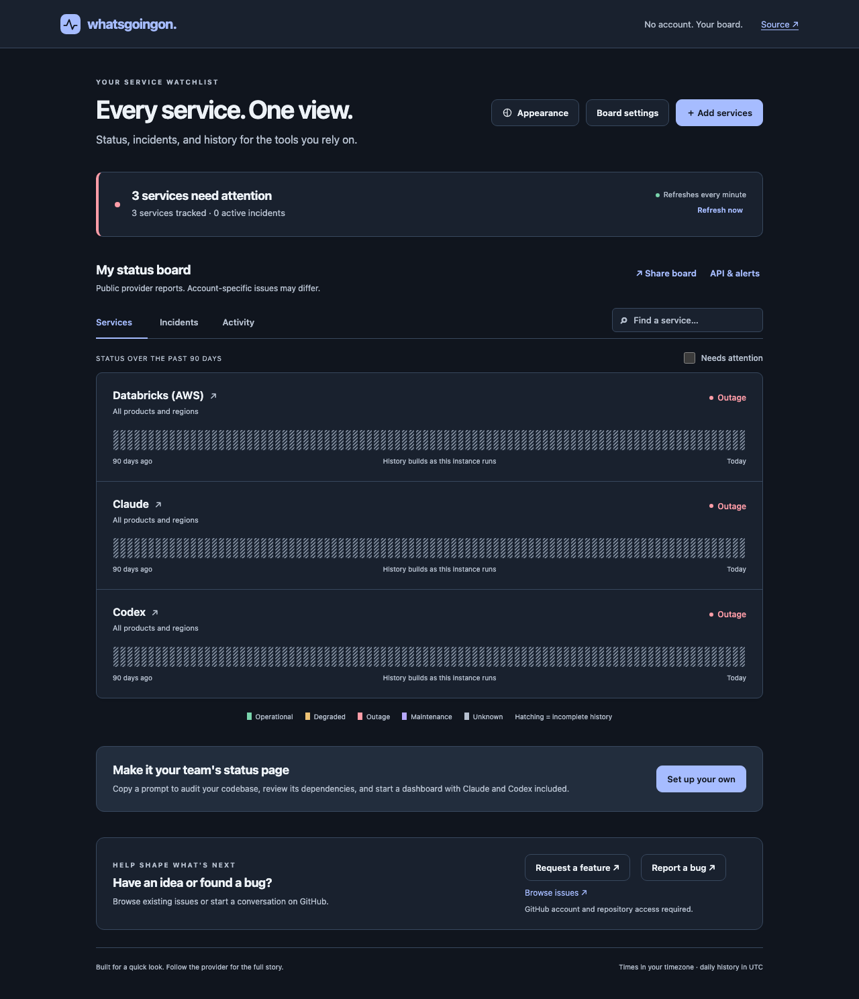

# whatsgoingon

A personal status board for the services you rely on. Open it, choose providers and components, and keep an eye on incidents. No sign-in or provider credentials required.



## Try it

Use Node.js 24 or later.

```sh
git clone https://github.com/NicholasTing/whatsgoingon.git
cd whatsgoingon
npm ci
npm run dev
```

Open <http://localhost:4173>. Databricks (AWS) is on the default board. Select its name, choose a region such as **AP Southeast 2**, select **Only these results**, and save. Use **Add services** for Claude, Codex, or another provider.

The frontend reloads while you edit it. Restart the development server after changing backend files.

## Set up your organisation's page

Select **Set up your own** in the footer, optionally enter a page name, and choose a local preview or Docker setup. Copy the prompt into a coding-agent session opened in **your organisation's repository**. The agent audits application code, manifests, infrastructure, CI, and tool configuration before setting up the dashboard.

The audit produces an inventory with file-and-line evidence, confidence, product/region scope, and proposed monitors. It includes Claude and Codex as setup defaults. Review the list with the agent, resolve uncertain scopes, and add or remove services. Your current board is a starting point; the final board also includes the agreed audit findings. Unsupported or private services remain visible as gaps.

The agent then configures and starts the dashboard in a separate directory. It sets the agreed board as the default for new visitors and exports it for existing browsers. It monitors the dependencies it finds; it does not provision the organisation's infrastructure.

You can also copy the [standalone setup prompt](docs/setup-prompt.md) and append your board JSON or hosting preferences. Without a starting board, it uses the audit findings, Claude, Codex, and a local preview. The agent needs access to both the organisation codebase and this repository; private repositories require GitHub access.

Review custom monitor URLs before sharing the prompt. Keep credentials in your own environment. The prompt prepares an agent task; it does not run or deploy the app from your browser.

## What you can use

- Public provider status, component and region filters, incident updates, and scheduled maintenance.
- A searchable catalogue, plus custom Statuspage-compatible pages and public HTTPS endpoint checks. Endpoint checks include response time, optional expected text, and TLS certificate expiry.
- Boards saved in your browser, groups, import/export, share links, and iframe embeds. Shared boards use fresh public data; each recipient controls their own copy.
- Dark appearance for new and legacy boards without a saved theme; explicit saved choices stay intact. An **Appearance** panel with light and dark presets, custom accent and status colours, a preview, and contrast checks. Appearance stays with the board when you reload, export, or share it.
- Daily observations and retained incident reports in SQLite. Select a history day (click, or arrow keys then Enter/Space) or current status to inspect related reports and open the official incident. Reports follow your selected components and UTC dates. Missing reports and history remain explicit.
- Browser alerts while the page is open. Your own running instance can send background alerts through generic webhooks, Slack, Discord, Teams workflows, or PagerDuty.
- A read-only JSON API, incident RSS feed, and embeddable status badges.

## Data and credentials

Board configuration is stored in local browser storage. Share links contain the board name, selected services and components, groups, and custom monitor URLs. They are configuration snapshots, not private or collaboratively edited workspaces.

The server fetches public status pages and stores public observations in `.data/status.sqlite`. Custom monitor URLs and expected text are sent to the server so it can perform the check. Use public targets only. There are no analytics, required API keys, or credentials bundled with the app.

Webhook settings entered in **API & alerts** are kept in that dialog until downloaded. They are not sent to the hosted server or saved in the board. To run background alerts, download `watch.config.json` and use it on your own instance:

```sh
npm run build
WATCH_CONFIG=./watch.config.json npm start
```

Keep this file private: webhook URLs and routing keys can contain credentials. The filename, `.env` files, and `.data/` are ignored by Git. The collector stores pending deliveries locally, including their destinations. Protect and back up the data directory as you would the configuration file.

The collector establishes a baseline on startup, then sends changes. It retries failed deliveries with backoff. Delivery is at least once: receivers should deduplicate using the `X-Whatsgoingon-Event-Id` header. Failed deliveries remain in SQLite after their retry budget is exhausted. Restarting with the same data directory preserves history, baselines, and pending deliveries.

For Slack, Discord, and Teams, use your own incoming webhook URL. For PagerDuty, use the Events API endpoint and your integration's routing key. Generic webhooks can connect other notification systems without adding their credentials to this repository.

## Run a server

```sh
npm ci
npm run build
HOST=0.0.0.0 PORT=4173 npm start
```

Use an HTTPS reverse proxy for a public deployment. Mount a persistent volume at the directory selected by `DATA_DIR` (default `.data`). The app works with no authentication because the server API is read-only and serves public status data. It is not a place to store private endpoints or customer account information.

A Docker setup is included:

```sh
docker compose up --build -d
```

It exposes port 4173 and keeps observations in a named volume. To enable alerts, mount your own `watch.config.json` read-only and set `WATCH_CONFIG` to its container path. Do not bake that file into an image.

For a deployment you want to keep, run one continuously available instance with a persistent disk and backups stored on another system. See [persistence and recovery](docs/persistence.md) for volume reuse, browser board exports, storage choices, and backup and restore steps.

`npm run build` produces the browser assets. A static deployment, including Vercel’s Vite preset, also needs the Node backend: route `/api/*` to an instance with persistent storage. Otherwise, provider requests return a missing-page response and the board reports that the status service is unavailable. Running the backend as serverless functions requires external persistence and scheduled collection; a temporary SQLite file will lose history when the instance is replaced.

## API

Examples below use the default local server. Add repeated `component` parameters to scope a provider's status or history.

```text
GET /api/catalog?q=databricks
GET /api/status/databricks
GET /api/history/databricks
GET /api/incidents?providers=databricks,claude,codex
GET /api/feed.xml?providers=databricks,claude,codex
GET /api/badge/databricks.svg
GET /api/health
```

The status response includes component IDs, current state, incident updates, observation timestamps, and stale-data warnings. Each history day separates local check counts (`samples`) from matching provider report counts (`reports`). A reported incident can colour a day with no local checks. With neither checks nor reports, the day stays unknown; partial local coverage is never proof of all-day health. This is not an uptime SLA measurement. Unknown or stale feeds do not become healthy by default.

The UI generates custom monitor URLs and configuration exports. Custom endpoints must use public HTTPS without embedded credentials, query strings, fragments, or a nonstandard port. The server validates DNS answers, pins the destination address, blocks private networks, does not follow redirects, and limits response sizes and request rates.

## Checks

```sh
npm run check
npx playwright install chromium
npm run test:e2e
```

Unit tests cover feed normalization, component scope, stale data, history gaps, public URL validation, configuration sharing, and webhook retries. Browser tests cover the Databricks flow, board isolation, keyboard navigation, mobile layout, automated accessibility, and credential handling. Browser tests use deterministic provider responses; live provider checks should also be performed when changing an adapter.

CI runs these checks on pushes and pull requests, plus `npm audit --audit-level=high` for known dependency vulnerabilities. Dependabot proposes weekly npm and GitHub Actions updates. Major npm updates remain separate for review.

The CodeQL workflow scans JavaScript and TypeScript on public repositories and skips private repositories. It also runs weekly and supports manual runs. See [GitHub's code scanning availability](https://docs.github.com/en/code-security/concepts/code-scanning/codeql/codeql-code-scanning). Standard GitHub-hosted runners are [free for public repositories](https://docs.github.com/en/billing/concepts/product-billing/github-actions); private repositories use the owner's included allowance.

Pull requests receive automated reviews from [CodeRabbit](https://www.coderabbit.ai), configured in `.coderabbit.yaml`. It is free for public repositories and is not bundled with the app or required by CI. Forks need their own installation if they want it.

## Feedback

Use **Request a feature** or **Report a bug** in the footer to open the matching GitHub issue form. You can also [browse existing issues](https://github.com/NicholasTing/whatsgoingon/issues). Submitting an issue requires a GitHub account and access to the repository; a private repository cannot accept reports from the general public.

The forms are configured in `.github/ISSUE_TEMPLATE/` and apply the `bug` or `enhancement` label. GitHub Discussions can be enabled separately for broader conversations; issue forms cover the feedback flow here. If you fork the project, change `GITHUB` in `src/App.tsx` to direct feedback to your repository.

## Contributing

Contributions are welcome. Read [CONTRIBUTING.md](CONTRIBUTING.md) for setup, checks, and the pull request process, and follow the [Code of Conduct](CODE_OF_CONDUCT.md). Report security vulnerabilities privately as described in [SECURITY.md](SECURITY.md).

## Limits

Public provider reports can lag failures and cannot establish the health of a specific account. Databricks' built-in feed covers AWS. Its current feed does not provide a complete resolved-incident archive, so this app accumulates observations as it runs. Other providers expose differing amounts of historical data.

Browser alerts depend on browser support and an open page. Background alerts require your own running instance and notification destination. Endpoint checks run from that instance, not a global probe network. RSS includes catalogue providers and is provider-wide.

Licensed under [MIT](LICENSE).
